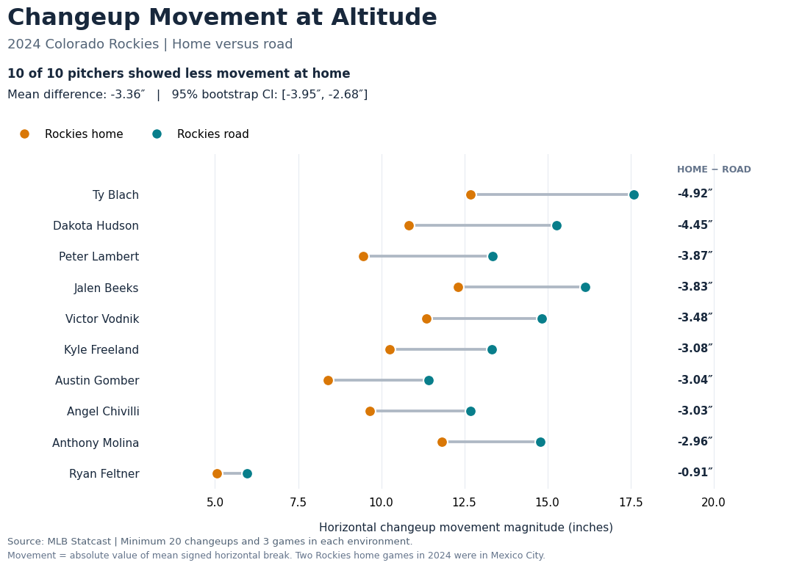
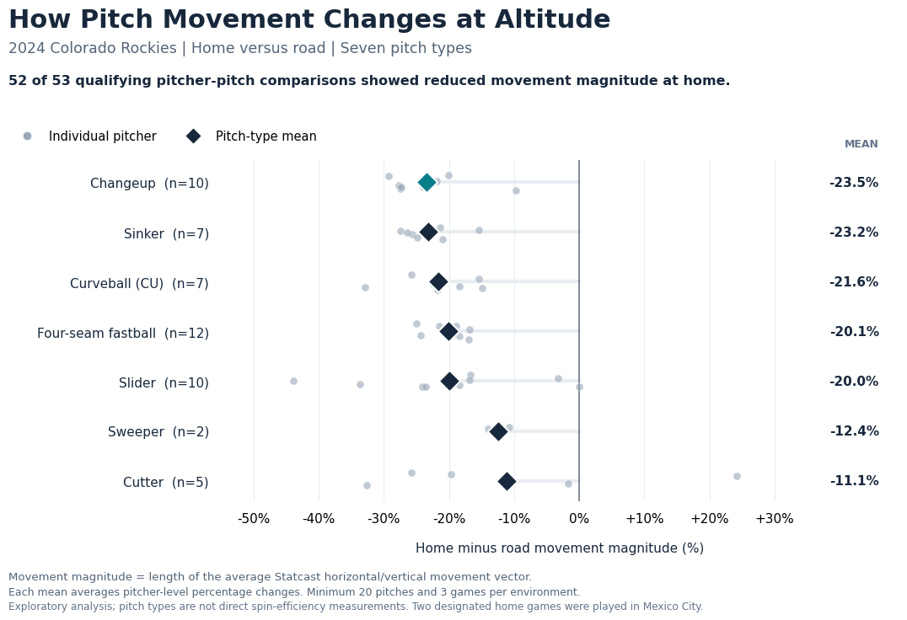
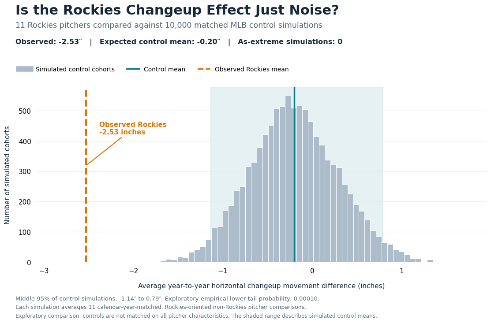

# Pitch Movement at Coors Field

**Author: Paul J Gornick**

Independent baseball analytics research project examining pitch movement during Colorado Rockies seasons and in Rockies-designated home versus road games, using MLB Statcast data.

This repository includes the complete original Google Colab notebook as the **master research record**, three curated notebooks for easier reading, and three figures exported from the analysis. The master is an exact, unedited copy of the original research notebook. The curated notebooks preserve the existing methods and displayed results, but have not been re-executed from a clean Colab runtime.

## Full research paper

**[Read the research paper (PDF)](Pitch_Movement_at_Altitude_Research.pdf)** · [Editable Word version](Pitch_Movement_at_Altitude_Research.docx) · [Markdown source](Pitch_Movement_at_Altitude_Research.md)

The paper contains the methodology, three figures, audited results, limitations, and opportunities for future research. The paper should be treated as the narrative reference for final claims, while the original notebook remains the chronological research record.

## Key results

- **Primary, usage-selected 2024 changeup cohort:** Ten qualifying Rockies pitchers all showed lower horizontal changeup movement magnitude in designated home games than in road games. Mean home-minus-road difference: **−3.36 inches**; 95% pitcher-level bootstrap interval: **[−3.95, −2.68] inches**.
- **Seasonal exploratory changeup comparison:** Eleven pitchers with neighboring Rockies/non-Rockies seasons had a mean movement difference of **−2.53 inches**. Calendar-year-oriented placebo simulations using non-Rockies pitchers had an expected mean near −0.20 inches; **0 of 10,000** simulated cohorts had an average as negative as the observed result. This is an exploratory comparison, **not a causal probability**.
- **2024 seven-pitch-type extension:** Across 17 pitchers, 53 pitcher–pitch comparisons met the exposure criteria, and **52 of 53** showed lower overall movement-vector magnitude in designated Rockies home games. Different pitch types from the same pitcher are not independent observations.

**Interpretation:** Movement differences do **not** by themselves demonstrate a loss of pitch effectiveness. Home-versus-road associations do **not** establish that altitude alone causes the differences.

## Figures

### Figure 1 — 2024 changeup movement: Rockies home versus road

All ten qualifying pitchers showed lower horizontal changeup movement magnitude in designated home games. The average within-pitcher difference was **−3.36 inches** (95% pitcher-level bootstrap interval: **−3.95 to −2.68 inches**).

### Figure 2 — Exploratory home–road movement differences by pitch type

Of the 53 qualifying pitcher–pitch comparisons, **52 showed reduced movement-vector magnitude at home**. The number of pitchers varies by pitch type, and the plotted movement metric is not a measure of spin efficiency or pitch effectiveness.

### Figure 3 — Rockies changeup transitions versus MLB year-to-year variation

In 10,000 exploratory calendar-year-matched placebo simulations, no control cohort mean was as negative as the observed Rockies seasonal changeup difference (**−2.53 inches**). Controls were not fully matched on pitcher characteristics; the simulation does not identify a causal effect.

## Master notebook and research lineage

[**00 — Master full research notebook**](00_master_full_research.ipynb) is the unedited, chronological record of the project, including exploratory tests, intermediate findings, methodological audits, and plotting work. It is preserved so the development of the analysis and its decisions remain traceable. Not every exploratory result in it should be treated as a final claim.

The three notebooks below are curated presentations of that work, intended to help reviewers follow the analytical workflow without reading every investigation in the master notebook. The audited findings reported in **this README and the research paper** should be treated as authoritative if preliminary results in the master notebook differ. Changes to analytical methods should be made in a clearly versioned follow-up rather than silently altering the master research record.

## Curated notebook execution order

1. [**01 — Seasonal discovery**](01_seasonal_discovery.ipynb) — Source imports, player-season master data, team-transition sample, and movement calculations. Requires the original sixteen Baseball Savant full-season CSV exports in a Google Drive folder, named as the code expects.
2. [**02 — Changeup validation**](02_changeup_validation.ipynb) — Matched placebo simulations, individual-pitch Statcast home/road retrieval, 2024 changeup validation, and bootstrap interval.
3. [**03 — Pitch types, audits, and figures**](03_pitch_types_audit_and_figures.ipynb) — Seven-pitch-type extension, integrity checks, and the three research figures.

At the top of each curated notebook, edit `PROJECT_DIR` to the folder containing the Baseball Savant exports and generated CSV files. The default is `/content/drive/MyDrive/Coors Project`. Run cells top-to-bottom in Google Colab. The computations use the MLB Stats API and `pybaseball` for additional data and require network access.

The notebooks are sequenced but not self-contained: Notebook 02 requires outputs from Notebook 01, and Notebook 03 requires outputs from both preceding notebooks. Data and API results may differ from the preserved notebook outputs if upstream sources change.

**Captured research environment:** Python 3.13.18; pandas 2.2.3; NumPy 2.1.3; SciPy 1.16.3; Matplotlib 3.10.0; requests 2.32.4; pybaseball 2.2.7. See [requirements.txt](requirements.txt). The raw Baseball Savant exports and Statcast caches are not distributed in this repository.

## Important methodological notes

- **Venue:** Two Colorado-designated home games in 2024 were played at Mexico City's Estadio Alfredo Harp Helú, not Coors Field. The existing figures retain them as Rockies home games. Accordingly, findings are labeled *designated Rockies home versus road*, not exclusively *Coors Field versus road*.
- **Curveball definition:** `CU` (conventional curveball) was included; `KC` (knuckle curve) was not combined with it. The audit identified `KC` records for Kyle Freeland and Austin Gomber, explaining two otherwise eligible curveball combinations that were not matched as `CU`.
- **Movement measures:** Horizontal changeup movement is the absolute value of mean signed horizontal break. In the seven-pitch analysis, two-dimensional movement magnitude is `sqrt((mean(pfx_x) * 12)^2 + (mean(pfx_z) * 12)^2)`: the **magnitude of the mean movement vector**, not the mean of individual pitch magnitudes. Statcast `pfx_x` and `pfx_z` are measured in feet.
- **Sample rules:** For the 2024 validation, pitchers needed at least 20 pitches across at least three games in each environment. The primary confidence interval resamples pitchers, not individual pitches.
- **Control analysis:** Non-Rockies controls were matched on calendar years and comparison orientation, not perfectly matched on velocity, pitch design, age, or organizational context. Changeups were selected for detailed study after exploratory pitch-type screening, so significance results are exploratory.
- **Spin mechanism:** Pitch classifications do not directly measure active spin or gyro spin. The hypothesis that gyro-heavy pitches retain more movement at altitude remains untested by direct spin-efficiency measurements.
- **Scope:** This project does not estimate run value, pitcher quality, pitch effectiveness, or the isolated causal contribution of altitude.

## Reproducibility status

The master notebook preserves the complete research record, and the three curated notebooks organize the workflow. The curated notebooks **have not yet been executed end-to-end in a clean Colab runtime**. To reproduce the full analysis, obtain the original 16 Baseball Savant CSV exports, configure `PROJECT_DIR`, and retrieve the relevant public MLB API / Statcast data. The paper and figures reflect the audited research snapshot. Clean-runtime reproduction remains future work.
